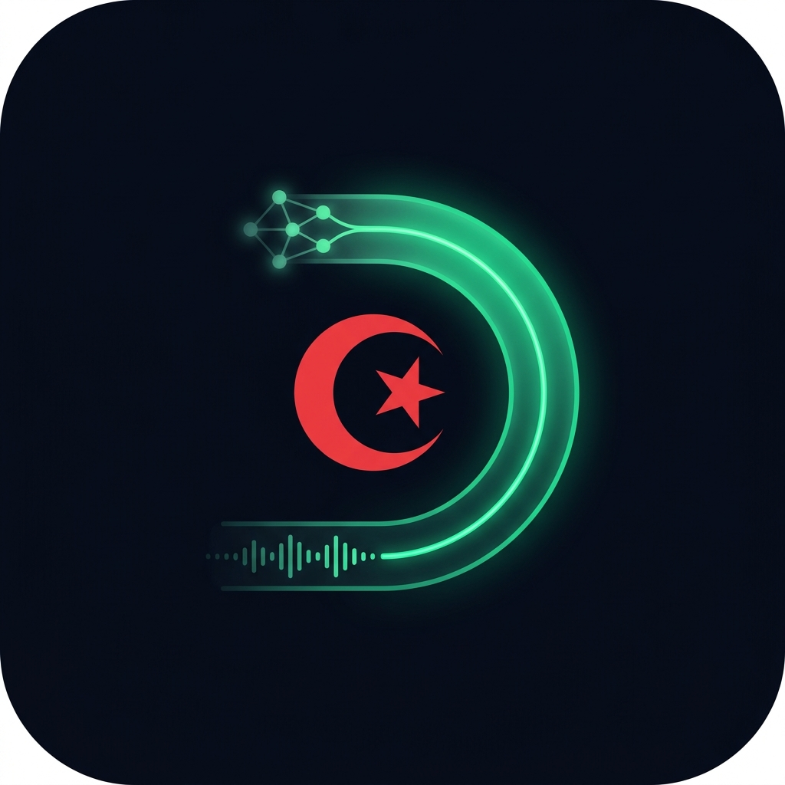

<div align="center">
  
  <h1>darja-nlp-kit</h1>
  <p><strong>Zero-dependency, dual-language (TypeScript & Python) NLP toolkit for Algerian Darja</strong></p>

  <p>
    <a href="https://github.com/test-bit-sys/darja-nlp-kit/actions/workflows/ci.yml"></a>
    <a href="https://test-bit-sys.github.io/darja-nlp-kit/"></a>
    <a href="https://www.npmjs.com/package/@dz-open-suite/darja-nlp-kit"></a>
    <a href="https://pypi.org/project/darja-nlp-kit/"></a>
    <a href="#"></a>
    <a href="LICENSE"></a>
  </p>
  <p>
    <strong><a href="https://test-bit-sys.github.io/darja-nlp-kit/">Interactive Web Playground &rarr;</a></strong>
  </p>
</div>

Zero-dependency, dual-language (TypeScript & Python) NLP toolkit for **Algerian Darja** (Derja) — part of the **DZ Open Suite** ecosystem.

Handles Arabic script, Arabizi (Latin transliteration with numbers), and French/Arabic code-switching common in Algerian e-commerce, social media, and daily communication.

## Features

- **Text Normalization** — Unify Arabic letter variants, strip diacritics, reduce character elongation
- **Arabizi-to-Arabic Transliteration** — Smart conversion with 220+ French loanwords whitelist, digraph mappings, and context-sensitive numbers
- **Stopword Removal** — 545+ categorized Algerian Darja stopwords (Arabic script + Arabizi) with prefix stripping
- **Tokenization** — Mixed-script tokenization with circumfix negation detection (ما...ش / ma...ch)
- **Sentiment Analysis** — Score-based analysis with negation inversion, double negation, intensifier scaling, and code-switching support (330+ entries)
- **Algerian Geo, Logistics & Entity Extraction** — Full coverage of all 69 wilayas (Law 26-06 reform), carriers (Yalidine, ZR Express, Maystro, Procolis, EMS, Kazitour, Guepex), delivery mode (Stop Desk / Home Delivery), Algerian phone numbers, payments (BaridiMob, Edahabia, CCP, COD), and Darja colloquial prices (`زوج ملاين` $\rightarrow$ 20,000 DZD, `3 mlayen` $\rightarrow$ 30,000 DZD)
- **Regional Dialect Identification** — Detect regional dialects: WEST (Oran/Tlemcen), EAST (Constantine/Setif), CENTER (Algiers/Blida), SOUTH, or GENERAL_DARJA
- **Colloquial Quantities & Product Attributes** — Extract colloquial quantities (`حبة`, `زوج حبات`, `شكارة`, `باكية`, `كرطونة`, `دوزينة` = 12), clothing sizes (XS–3XL), shoe sizes (35–48), and Algerian color names (`كحل / noir`, `بيض / blanc`, etc.)
- **Telecom Operator Routing & Direct WhatsApp URLs** — Classify Algerian phone numbers by operator (`MOBILIS`, `DJEZZY`, `OOREDOO`, `ALGERIE_TELECOM`) and generate instant 1-click WhatsApp deep links (`https://wa.me/213...`)
- **Smart Human Escalation Engine** — Detect angry customers (`حشيتوهالي`, `سراقين`), explicit requests for human agents (`احكي مع بنادم`, `appel moi`), and legal threats (`نشكي بيكم`, `لابوليس`) with urgency levels (CRITICAL, HIGH, MEDIUM)
- **Zero-Dependency CLI & Local HTTP Microservice** — Instantly run a production-ready, CORS-enabled REST API and CLI commands with zero external packages for n8n, Make.com, webhooks, and local containers
- **AI Agent & LLM Middleware** — Pre-packaged grounding engine & dialect-mirroring system prompt generator for AI Agents (GPT-4o, Claude, Gemini, Llama) to deliver ultra-realistic human responses to Algerian customers without hallucination

## Installation

### Python

```bash
cd packages/python
pip install -e .
```

Or via PyPI:
```bash
pip install darja-nlp-kit
```

### TypeScript / JavaScript

```bash
cd packages/js
npm install
npm run build
```

Or via npm:
```bash
npm install @dz-open-suite/darja-nlp-kit
```

### Data Sync

Both packages consume shared linguistic data from `/data`. Run the sync script after any data changes:

```bash
python scripts/sync_data.py
```

## API Reference

### `normalize(text, options?)`

Normalizes Algerian Darja text by unifying Arabic letter forms and cleaning noise.

**Transformations:**
- Alef variants (أ, إ, آ) to bare alef (ا)
- Ta marbuta (ة) to ha (ه)
- Alef maqsura (ى) to ya (ي)
- Strip tashkeel (diacritics) and tatweel (kashida)
- Reduce character elongation (بزاااااف to بزاف, haaaayel to hayel)
- Normalize whitespace and punctuation

**TypeScript:**
```typescript
import { normalize } from '@dz-open-suite/darja-nlp-kit';

normalize('بِسْمِ اللَّهِ');
// => 'بسم الله'

normalize('كتـــاب');
// => 'كتاب'

normalize('بزاااااف');
// => 'بزاف'

normalize('haaaayel');
// => 'hayel'
```

**Python:**
```python
from darja_nlp import normalize

normalize('بِسْمِ اللَّهِ')
# => 'بسم الله'

normalize('بزاااااف')
# => 'بزاف'
```

**Options:**

| Option | Type | Default | Description |
|---|---|---|---|
| `preserveTashkeel` / `preserve_tashkeel` | boolean | `false` | Keep Arabic diacritics |
| `preserveLength` / `preserve_length` | boolean | `false` | Keep character repetitions |

---

### `arabiziToArabic(text, options?)` / `arabizi_to_arabic(text, options?)`

Converts Arabizi (Latin-script Algerian Arabic) to Arabic script with smart code-switching awareness.

**Features:**
- French loanword preservation via whitelist + suffix heuristics (`-tion`, `-ment`, `-eur`, `-ique`)
- French words containing Arabizi digraphs (`achat`, `chambre`, `douche`, `marche`, `couleur`, `bouton`, `retour`, `choix`, `chargeur`, `compte`, `boutique`) are preserved intact
- Irregular Darja dictionary overrides (`slm`, `cv`, `nchallah`, `hamdoulah`, `2ana`)
- Digraph mappings applied before single characters (`ch`, `kh`, `gh`, `sh`, `ou`, `th`, `dh`)
- Context-sensitive number conversion (`3` to ع, `7` to ح, `9` to ق) only when adjacent to letters
- Standalone numbers (prices, phone numbers, postal codes) are preserved intact

**TypeScript:**
```typescript
import { arabiziToArabic } from '@dz-open-suite/darja-nlp-kit';

arabiziToArabic('Prix 2500 DA w livraison l 16');
// => 'Prix 2500 دا و livraison ل 16' (numbers 2500 and 16 preserved)

arabiziToArabic('2ana 9rib');
// => 'انا قريب'

arabiziToArabic('produit mli7 livraison rapide');
// => 'produit مليح livraison rapide' (French words preserved)

arabiziToArabic('slm cv?');
// => 'سلام صافا?'
```

**Python:**
```python
from darja_nlp import arabizi_to_arabic

arabizi_to_arabic('Prix 2500 DA w livraison l 16')
# => 'Prix 2500 دا و livraison ل 16'

arabizi_to_arabic('2ana 9rib')
# => 'انا قريب'
```

**Options:**

| Option | Type | Default | Description |
|---|---|---|---|
| `preserveFrench` / `preserve_french` | boolean | `true` | Keep detected French words intact |

---

### `tokenize(text)`

Tokenizes mixed Arabic/Latin text and detects Algerian circumfix negation patterns (`ما...ش` / `ma...ch`).

**TypeScript:**
```typescript
import { tokenize } from '@dz-open-suite/darja-nlp-kit';

const result = tokenize('مافهمتش الحاجة');
// result.tokens => ['مافهمتش', 'الحاجة']
// result.negations => [{ original: 'مافهمتش', root: 'فهمت', negated: true }]
```

**Python:**
```python
from darja_nlp import tokenize

result = tokenize('مافهمتش الحاجة')
# result.tokens => ['مافهمتش', 'الحاجة']
# result.negations[0].root => 'فهمت'
```

---

### `removeStopwords(text)` / `remove_stopwords(text)`

Removes Algerian Darja stopwords from text with support for common Arabic prefix stripping (`ال`, `ب`, `و`, `ل`). Handles both Arabic script and Arabizi.

**TypeScript:**
```typescript
import { removeStopwords, isStopword } from '@dz-open-suite/darja-nlp-kit';

isStopword('بالزربة');
// => true

removeStopwords('المنتوج هايل بالزربة');
// => 'المنتوج هايل'

removeStopwords('had produit ta3 hayel');
// => 'produit hayel'
```

**Python:**
```python
from darja_nlp import remove_stopwords, is_stopword

is_stopword('بالزربة')
# => True

remove_stopwords('المنتوج هايل بالزربة')
# => 'المنتوج هايل'
```

---

### `analyzeSentiment(text)` / `analyze_sentiment(text)`

Analyzes sentiment with support for negation inversion, double negation, intensifiers, Arabic prefixes, and code-switching.

**Returns:**

| Field | Type | Description |
|---|---|---|
| `score` | number | Aggregated score between -1.0 and +1.0 |
| `label` | string | `POSITIVE`, `NEGATIVE`, `NEUTRAL`, or `MIXED` |
| `positiveTokens` / `positive_tokens` | string[] | Words contributing positively |
| `negativeTokens` / `negative_tokens` | string[] | Words contributing negatively |
| `negated` | boolean | Whether negation was detected |

**TypeScript:**
```typescript
import { analyzeSentiment } from '@dz-open-suite/darja-nlp-kit';

// Double negation: properly inverts negative to POSITIVE
analyzeSentiment('ماشي عيان');
// => { score: 0.68, label: 'POSITIVE', positiveTokens: ['عيان'], negativeTokens: [], negated: true }

analyzeSentiment('machi 3ayan');
// => { score: 0.68, label: 'POSITIVE', positiveTokens: ['3ayan'], negativeTokens: [], negated: true }

// Prefix support on nouns and adjectives
analyzeSentiment('المنتوج هايل');
// => { score: 0.9, label: 'POSITIVE', positiveTokens: ['هايل'], negativeTokens: [], negated: false }

// Intensifier scaling
analyzeSentiment('هايل بزاف');
// => { score: 0.9, label: 'POSITIVE', ... }

// Mixed reviews
analyzeSentiment('هايل بصح غالي');
// => { label: 'MIXED', positiveTokens: ['هايل'], negativeTokens: ['غالي'], ... }
```

**Python:**
```python
from darja_nlp import analyze_sentiment

result = analyze_sentiment('ماشي عيان')
# result.label == 'POSITIVE'
# result.score > 0
# result.negated == True

result = analyze_sentiment('المنتوج هايل')
# result.label == 'POSITIVE'
# result.score == 0.9
```

---

### `extractEntities(text)` / `extract_entities(text)`

Extracts Algerian entities:
- **Wilayas (69 Provinces) & 550+ Communes**: Matches by postal codes (`16`, `31`, `w16`), Arabic/French names (`الجزائر`, `Alger`, `بوسعادة`), popular aliases (`البهجة`, `الباهية`, `سيرتا`), and **550+ major Algerian communes** (e.g. `Rouiba`, `El Eulma`, `Ain El Turk`, `Hassi Messaoud`) which automatically resolve to their parent Wilaya with a `commune` property. Fully compliant with Law 26-06.
- **Payment Methods**: `BARIDIMOB`, `EDAHABIA` (البطاقة الذهبية), `CCP`, `COD` (الدفع عند الاستلام).
- **Compound Colloquial Prices**: Accurately parses compound Algerian centimes and dinars:
  - `زوج ملاين و خمسمية الف` / `2 mlayen w 500 alf` $\rightarrow$ 25,000 DZD
  - `زوج ملاين و خمسين الف` $\rightarrow$ 20,500 DZD
  - `مليون و ميتين الف` $\rightarrow$ 12,000 DZD
- **Delivery Carriers & Modes**: `YALIDINE`, `ZR_EXPRESS`, `MAYSTRO`, `PROCOLIS`, `EMS`, `KAZITOUR`, `GUEPEX`, plus `STOP_DESK` (استلام من المكتب) vs `HOME_DELIVERY` (توصيل للدار).
- **Phone Numbers**: Normalizes mobile/landline numbers (`05xx`, `06xx`, `07xx`, `+213`, `00213`) to standard 10-digit format.

**TypeScript:**
```typescript
import { extractEntities } from '@dz-open-suite/darja-nlp-kit';

const res = extractEntities('livrili l Rouiba b 2 mlayen w 500 alf b yalidine stop desk num: 0555123456');
// res.wilayas => [{ code: 16, codeStr: '16', nameAr: 'الجزائر', nameFr: 'Alger', commune: 'Rouiba', matchedText: 'Rouiba' }]
// res.prices => [{ raw: '2 mlayen w 500 alf', amount: 25000, currency: 'DZD' }]
// res.deliveries => [{ company: 'YALIDINE', label: 'Yalidine Express (ياليدين)', matchedText: 'yalidine' }]
// res.deliveryMode => { mode: 'STOP_DESK', label: 'Stop Desk (استلام من المكتب)' }
// res.phones => [{ raw: '0555123456', normalized: '0555123456' }]
```

**Python:**
```python
from darja_nlp import extract_entities

res = extract_entities('livrili l Rouiba b 2 mlayen w 500 alf b yalidine stop desk num: 0555123456')
# res.wilayas[0].code == 16
# res.wilayas[0].commune == 'Rouiba'
# res.prices[0].amount == 25000.0
# res.deliveries[0].company == 'YALIDINE'
# res.delivery_mode.mode == 'STOP_DESK'
# res.phones[0].normalized == '0555123456'
```

---

### `identifyIntent(text)` / `identify_intent(text)`

Classifies the customer's operational intent in Algerian Arabic / Arabizi / French code-switching:
- `ORDER`: طلب شراء أو حجز (e.g. *حاب نكوموندي*, *rani baghi nchri*, *ابعثوهالي للدار*)
- `PRICE_INQUIRY`: استفسار عن السعر (e.g. *بشحال هادي*, *شحال السومة*, *bch7al*, *c combien*)
- `AVAILABILITY_INQUIRY`: استفسار عن توفر السلعة والكمية (e.g. *كاينة منها*, *مازالت ديسبو*, *fih stock*)
- `DELIVERY_INQUIRY`: استفسار عن التوصيل والشحن (e.g. *شحال ليفريزون*, *وقتاش تلحق*, *كاين توصيل للدار*)
- `COMPLAINT`: شكوى أو استرجاع (e.g. *سلعة مكسرة*, *حشيتوهالي*, *روتور*, *سلعة عيانة*)
- `GREETING`: تحية وتواصل (e.g. *السلام عليكم*, *واش راك خويا*, *salam*, *azul*)
- `UNKNOWN`: غير محدد

**TypeScript:**
```typescript
import { identifyIntent } from '@dz-open-suite/darja-nlp-kit';

identifyIntent('سلام خاوتي حاب نكوموندي زوج حبات ابعثهالي للدار');
// => { intent: 'ORDER', confidence: 0.9, matchedKeywords: ['حاب', 'ابعثهالي'] }

identifyIntent('بشحال هاذي خاوة السومة تاعها؟');
// => { intent: 'PRICE_INQUIRY', confidence: 0.9, matchedKeywords: ['بشحال', 'السومة'] }
```

**Python:**
```python
from darja_nlp import identify_intent

res = identify_intent('سلام خاوتي حاب نكوموندي زوج حبات ابعثهالي للدار')
# res.intent == 'ORDER'
# res.confidence >= 0.8
```

---

### `detectDialect(text)` / `detect_dialect(text)`

Identifies regional Algerian dialect variants based on distinctive vocabulary:
- `WEST`: Oran, Tlemcen, Mostaganem (شوالا، شاكاين، غايا، باغي، حرز، درك، شراكم...)
- `EAST`: Constantine, Setif, Batna, Annaba (واشنهي، قداش، ياسر، ضرك، زي، باهي...)
- `CENTER`: Algiers, Blida, Tipaza, Boumerdes (واشنو، حكاية، دروك، هكدا، حوايج...)
- `SOUTH`: Adrar, Ghardaia, Ouargla, Bechar (واه، لاه، حتة...)
- `GENERAL_DARJA`: Neutral or common Algerian text

**TypeScript:**
```typescript
import { detectDialect } from '@dz-open-suite/darja-nlp-kit';

detectDialect('شوالا راك باغي خوية غايا؟');
// => { region: 'WEST', confidence: 0.9, detectedMarkers: ['شوالا', 'باغي', 'غايا'] }

detectDialect('واشنهي هادا قداش يدير ياسر باهي');
// => { region: 'EAST', confidence: 0.9, detectedMarkers: ['واشنهي', 'قداش', 'ياسر', 'باهي'] }
```

**Python:**
```python
from darja_nlp import detect_dialect

res = detect_dialect('شوالا راك باغي خوية غايا؟')
# res.region == 'WEST'
# res.confidence >= 0.9
```

## Data Files

All linguistic data lives in `/data` and is synced to both packages:

| File | Description |
|---|---|
| `wilayas.json` | All 69 Algerian Wilayas with Arabic/French names, codes, popular aliases, and **550+ commercial communes** |
| `stopwords.json` | 590+ categorized regional and general stopwords across 13 grammatical categories |
| `lexicon.json` | Algerian sentiment dictionary with 410+ authentic positive/negative phrases, idioms, 33 negators, and 44 intensifiers |
| `arabizi_rules.json` | Transliteration rules, 240+ French whitelist terms, and 130+ irregular Darja overrides |

### `buildAgentContext(message)` & `formatAgentSystemPrompt(context)`

Empower AI models (GPT-4o, Claude, Gemini, Llama) to act as realistic Algerian customer representatives. Extracts grounded facts (exact DZD price, confirmed Wilaya, delivery carrier, phone) and generates a dialect-mirroring, tone-calibrated system prompt with zero hallucinations.

**Python:**
```python
from darja_nlp import build_agent_context, format_agent_system_prompt

# 1. Build structured ground-truth context
ctx = build_agent_context(
    "salam khoya hab nchrih b 2 mlayen l Constantine b yalidine stop desk. num: 0661234567"
)

# 2. Generate enriched system prompt for LLM
prompt = format_agent_system_prompt(ctx)
# -> Ready to be sent to OpenAI / Anthropic / Gemini API
```

**TypeScript:**
```typescript
import { buildAgentContext, formatAgentSystemPrompt } from '@dz-open-suite/darja-nlp-kit';

const ctx = buildAgentContext(
  'salam khoya hab nchrih b 2 mlayen l Constantine b yalidine stop desk. num: 0661234567'
);
const prompt = formatAgentSystemPrompt(ctx);
```

### `detectEscalation(text)` — Smart Human Escalation & Agent Handoff

Detects when an Algerian customer conversation requires human agent takeover, classifying urgency (`CRITICAL`, `HIGH`, `MEDIUM`, `NONE`) and reason (`LEGAL_THREAT`, `ANGRY_CUSTOMER`, `HUMAN_REQUESTED`, `DISPUTE`).

```typescript
import { detectEscalation } from '@dz-open-suite/darja-nlp-kit';

detectEscalation('سراقين حشيتوهالي رجعولي دراهمي');
// => {
//   needsEscalation: true,
//   urgency: 'HIGH',
//   reason: 'ANGRY_CUSTOMER',
//   matchedTriggers: ['سراقين', 'حشيتوهالي', 'رجعولي دراهمي'],
//   guideline: '⚠️ الزبون غاضب جداً ويتهم المتجر بسوء النية أو السرقة. يجب تدخل عون بشري...'
// }

detectEscalation('نشكي بيكم للعدالة ولابوليس');
// => { needsEscalation: true, urgency: 'CRITICAL', reason: 'LEGAL_THREAT', ... }
```

### `extractQuantities(text)` & `extractProductAttributes(text)`

Extracts colloquial Algerian quantities and product specifications (colors, clothing sizes XS-3XL, shoe sizes 35-48).

```typescript
import { extractQuantities, extractProductAttributes } from '@dz-open-suite/darja-nlp-kit';

extractQuantities('حاب زوج حبات و 3 شكاير و دوزينة');
// => [
//   { raw: 'زوج حبات', value: 2, unit: 'حبة' },
//   { raw: '3 شكاير', value: 3, unit: 'شكارة' },
//   { raw: 'دوزينة', value: 12, unit: 'دوزينة' }
// ]

extractProductAttributes('بيجاما كحلة وبيضا مقاس XL وبونتير 42');
// => {
//   colors: ['كحل / noir', 'بيض / blanc'],
//   sizes: ['XL', '42']
// }
```

### Telecom Operator Routing & WhatsApp Deep Links

Automatically classifies Algerian phone numbers by telecom operator and creates 1-click WhatsApp chat links:

```typescript
import { extractEntities } from '@dz-open-suite/darja-nlp-kit';

const res = extractEntities('اتصل بي على 0661234567');
// res.phones[0]:
// {
//   normalized: '0661234567',
//   operator: 'MOBILIS',
//   operatorLabel: 'Mobilis (موبيليس)',
//   formatted: '+213 661 23 45 67',
//   whatsappUrl: 'https://wa.me/213661234567'
// }
```

## Zero-Dependency CLI

`darja-nlp-kit` comes with an instant command-line tool requiring zero extra dependencies:

```bash
# Parse all Algerian entities (Wilayas, communes, phones, prices, quantities)
darja-nlp parse "نحوس على 2 حبات مقاس XL نبعثهم لوهران 0661234567"

# Check human escalation status
darja-nlp escalation "سراقين حشيتوهالي رجعولي دراهمي"

# Intent classification
darja-nlp intent "شحال التوصيل لسطيف؟"

# Start local HTTP microservice server (for n8n, Make, Docker)
darja-nlp server --port 8080
```

## Zero-Dependency HTTP Microservice (for n8n, Make.com, Webhooks)

Run a high-performance local microservice using standard library HTTP servers:

```bash
# In Python
python -m darja_nlp.server

# Or in Node.js
node dist/cli.js server --port 8080
```

### Endpoints:
- `POST /api/agent-context` — Complete context & formatted prompt for LLMs (GPT-4o, Gemini)
- `POST /api/parse` — Entities, wilayas, phones, operator, prices, quantities, and attributes
- `POST /api/intent` — Customer intent classification
- `POST /api/escalation` — Human takeover detection
- `POST /api/quantities` — Algerian quantities & product attributes
- `POST /api/sentiment` — Score and positive/negative token breakdown
- `POST /api/dialect` — Regional dialect detection (WEST, EAST, CENTER, SOUTH)
- `GET  /api/wilayas` — List all 69 official Algerian Wilayas
- `GET  /api/wilayas/:code` — Wilaya details by code (1 to 69)

## Algerian AI Automation Blueprints (`/examples`)

Ready-to-use blueprints for Algerian developers and automation engineers:

| Blueprint | Description |
|---|---|
| `examples/whatsapp_ecommerce_bot.py` | Production WhatsApp Cloud API webhook bot with human escalation and grounded Darja replies |
| `examples/n8n_algerian_ecommerce_workflow.json` | Importable n8n workflow file connecting incoming leads, darja-nlp-kit, and Telegram/WhatsApp alerts |
| `examples/langchain_agent_tools.py` | OpenAI & LangChain function calling definitions for Algerian NLP |
| `examples/fastapi_ecommerce_service.py` | FastAPI microservice template |
| `examples/express_ecommerce_service.ts` | Express.js microservice template |

## Running Tests

### Python
```bash
cd packages/python
python -m pytest tests/ -v
```

### TypeScript
```bash
cd packages/js
npx tsx --test tests/index.test.ts
```

## Project Structure

```
darja-nlp-kit/
├── .github/
│   └── workflows/
│       ├── ci.yml             # GitHub Actions CI workflow
│       └── publish.yml        # Release publishing to npm & PyPI
├── data/                      # Shared linguistic datasets
│   ├── stopwords.json
│   ├── lexicon.json
│   └── arabizi_rules.json
├── packages/
│   ├── js/                    # TypeScript/JavaScript package
│   │   ├── src/
│   │   ├── tests/
│   │   ├── package.json
│   │   └── tsconfig.json
│   └── python/                # Python package
│       ├── darja_nlp/
│       ├── tests/
│       └── pyproject.toml
├── scripts/
│   └── sync_data.py           # Data sync utility
└── README.md
```

## License

MIT
